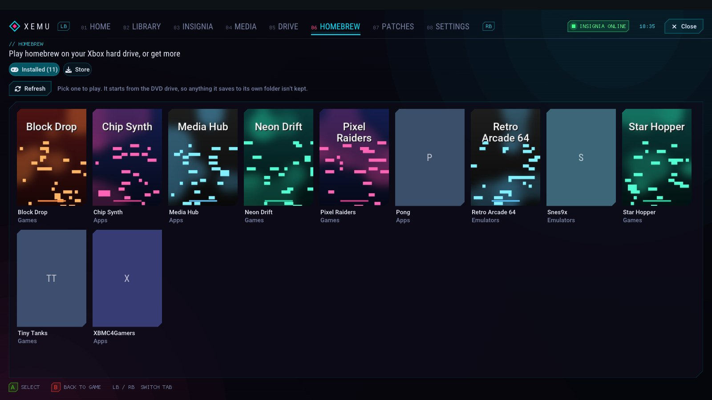
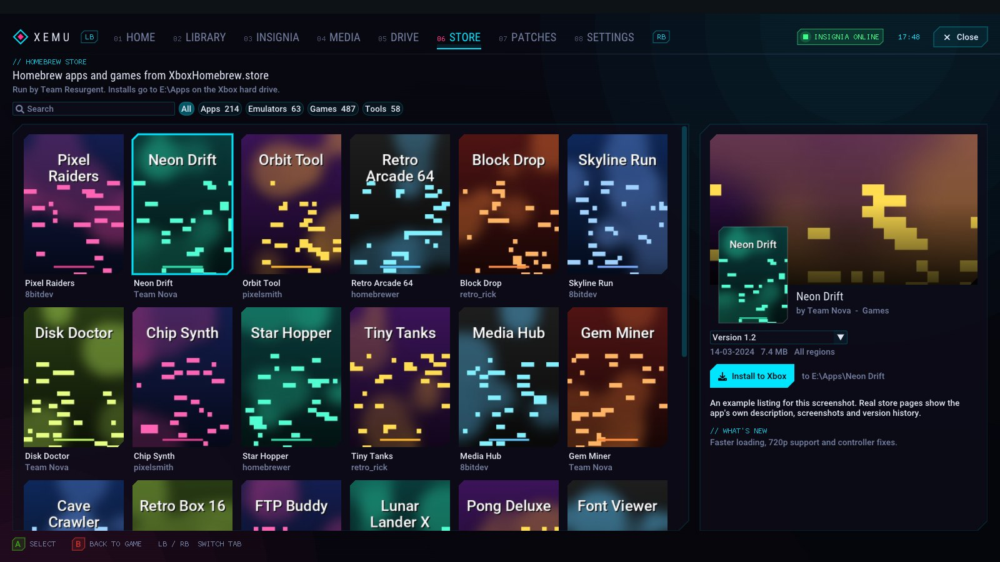
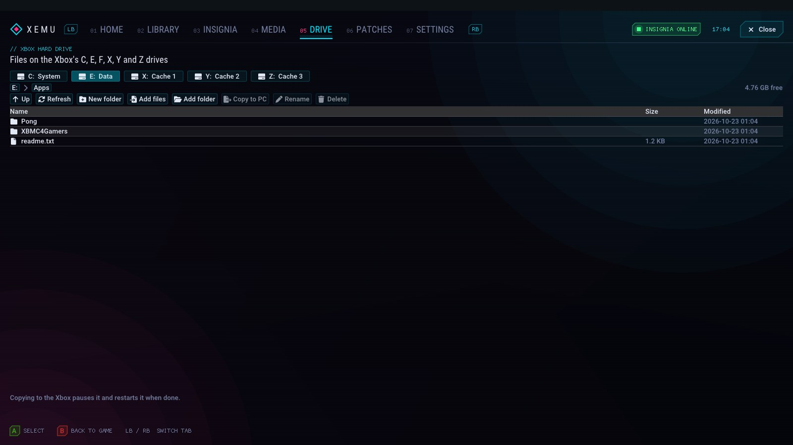
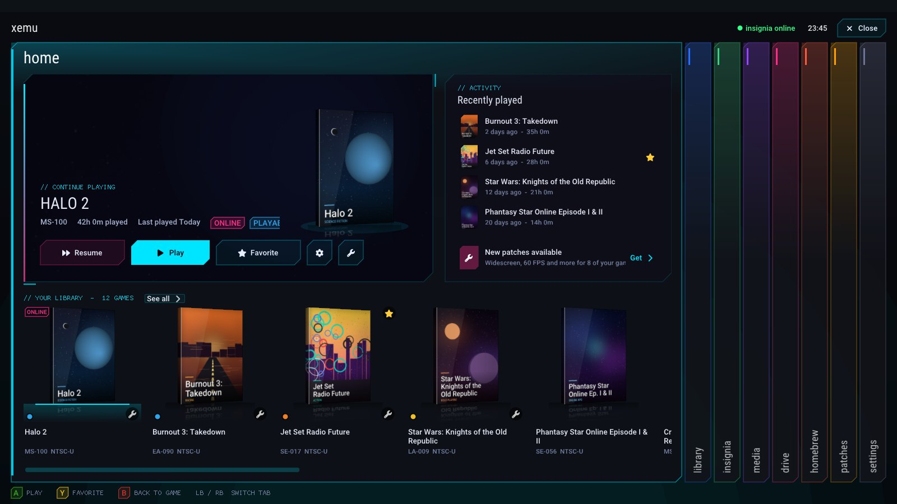
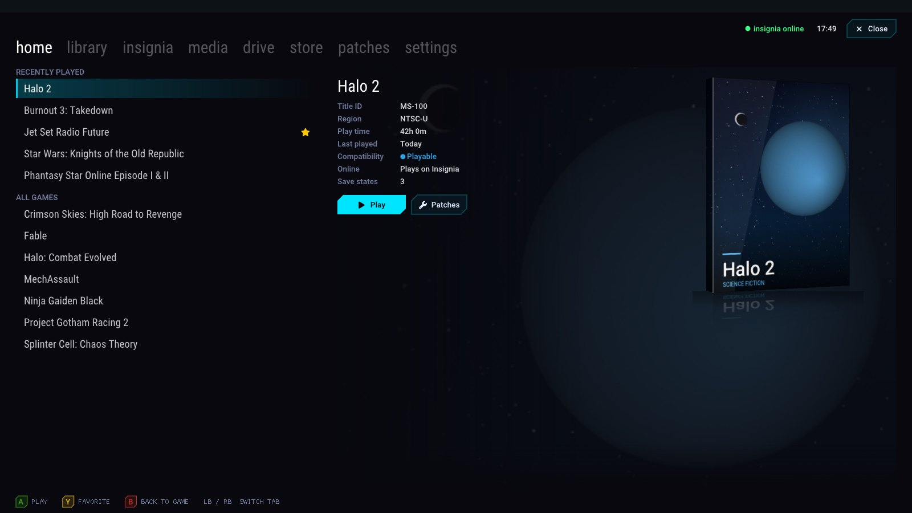

# xemu Modern GUI: an experimental xemu fork

> [!IMPORTANT]
> **This is an experimental fork of [xemu](https://xemu.app) for trying out
> user interface improvements.** It is not official xemu, and it is not made,
> endorsed or supported by the xemu project. Some of these ideas may never
> appear in xemu.
>
> - **Please don't ask about this build in xemu's Discord, GitHub or other
>   xemu channels**, and don't report its problems there. Open an issue in
>   this repository instead.
> - If something doesn't work, try official xemu before assuming xemu has
>   the problem.
> - For the official emulator, downloads and support, go to
>   [xemu.app](https://xemu.app).

This fork is based on xemu 0.8.139. Emulation is unchanged except where noted
under Performance and stability; the work here is on the interface: a
console-style dashboard, a homebrew tab, upscaling options and
quality-of-life features.

> **Agent Declaration**: These changes were created with assistance from
> Claude Code (Anthropic, Claude Opus 5.5).

| Library | Homebrew | Homebrew store | Drive |
|---|---|---|---|
|  |  |  |  |

| Insignia | Blades style | Metro style | Classic style |
|---|---|---|---|
|  |  |  |  |

Screenshots use original placeholder cover art (not the real box art), example compatibility ratings and invented example homebrew.

## Download

Windows builds are on the [Releases](../../releases) page. Unzip and run
`xemu.exe`. It uses the same settings folder as official xemu, so existing
settings, EEPROM and hard disk images carry over.

You still need your **own** MCPX boot ROM, BIOS (flash ROM) and hard disk
image, the same as with official xemu. They are not included and must not be
shared.

## What's added

- **New in v1.5: Homebrew tab.**
  - **Play** the homebrew on your Xbox hard disk image (`E:\Games`,
    `E:\Apps`, `E:\Emulators`) straight from the dashboard, no homebrew
    dashboard needed: xemu turns the app's folder into a disc image and boots
    it.
  - **Covers** from the store (also for apps you copied on yourself), your
    own `covers\<title ID>.png`, or the app's built-in title image.
  - **Right-click (or Y)** to delete an app or show it in the Drive tab.
  - **Get more** from [XboxHomebrew.store](https://xboxhomebrew.store) (run
    by Team Resurgent): search, browse by category, read about an app and its
    versions, then **Install to Xbox**. Games go to `E:\Games`, emulators to
    `E:\Emulators`, the rest to `E:\Apps`. Only homebrew is listed; firmware
    and Microsoft's dashboards are left out.
- **New in v1.4: compatibility ratings.** Each game shows its rating from
  xemu's community [compatibility list](https://xemu.app/#compatibility):
  a coloured dot on its cover, a badge on Home and a row in its details with
  a link to the report. Sort the library by it too.
- **New in v1.3: Blades and Metro styles.** Two more dashboard layouts:
  sliding side-by-side panels, or slim XBMC4Gamers-style lists. Save states
  also get a right-click menu (load, delete, show file).
- **New in v1.3: Xbox hard drive explorer.** A Drive tab to browse the
  emulated hard drive's C, E, F and X/Y/Z partitions and copy files and
  folders in and out, rename and delete (uses
  [libfatx](https://github.com/mborgerson/fatx)). Copying to the Xbox pauses
  it and restarts it afterwards.
- **New in v1.3: 3D game cases.** Covers on the Home screen stand as 3D game
  cases with a spine and a reflection, made from your existing covers. Use
  your own 3D box art by saving it as `covers\<title ID>-3d.png`, or switch
  back with Settings > Home screen covers. The Insignia status in the top bar
  is now color-coded (green, amber or red). Also new: **NVIDIA RTX Video (AI)**
  upscaling, using the RTX Video Super Resolution built into NVIDIA's driver
  (RTX cards, with the feature turned on in the NVIDIA app), and **NVIDIA
  Image Scaling (NIS)** for any GPU.
- **New in v1.3: motion.** The dashboard animates: flowing light ribbons, a
  slowly turning wireframe orb and drifting specks in the background (plus a
  grid floor in Neon), content that sweeps in when you switch tabs, a tab
  highlight that glides, and a selection glow. Turn it off with
  "Animations and moving background" in Settings.
- **New in v1.3: Neon theme.** A dark, cyberpunk look for the dashboard:
  near-black backgrounds, cyan and magenta accents, cut-corner panels and HUD
  labels. The previous green look stays available (Games > Library Style).
- **New in v1.1: Discord status.** While you play, your Discord profile shows
  the game you're playing, with its cover, title ID, play time and an Insignia
  badge for online-capable games. Turn it off in Settings > General > Discord
  status. Requires the Discord app running on the same PC.
- **Four library styles**, switchable any time from Games > Library Style or
  Settings: the tabbed **Dashboard**, **Blades**, **Metro**, or the
  **Classic** single library window.
- **Dashboard** with tabs, switched with LB / RB:
  - **Home:** continue your last game.
  - **Library:** your full game collection.
  - **Insignia:** online status, your online-capable games and setup steps.
  - **Media:** save states and screenshots.
  - **Drive:** the Xbox hard drive explorer.
  - **Homebrew:** play, delete or get more homebrew (XboxHomebrew.store).
  - **Patches** and **Settings.**
- **Upscaling filters:** AMD FidelityFX FSR 1.0, NVIDIA RTX Video (AI),
  NVIDIA Image Scaling (NIS),
  Lanczos, Bicubic and Snapdragon GSR 1, with a sharpening control.
- **Game library:**
  - Multiple game folders, cover art downloads and play time.
  - Favorites, per-game settings, preview videos and desktop shortcuts.
  - A "resume where you left off" option.
- **Patches:**
  - Per-game custom XBE, IPS, BPS and Magic Patch (.jmp) files, applied
    without modifying the disc image.
  - Download widescreen, 60 FPS and HD patches from
    [Jay's Magic Patches](https://github.com/JayYardley/Xbox-Magic-Patches-by-Jay).
- **Video mode switches:** widescreen, 480p, 720p and 1080i, the same as the
  Xbox dashboard's settings.
- **Insignia** (Xbox Live revival) integration: ONLINE badges, a status light
  and setup help.
- **Performance and stability:**
  - Vulkan shader and pipeline caches.
  - Higher-priority emulation threads.
  - A larger CPU code cache.
  - Windows power throttling turned off.
  - A performance overlay (F9).
  - Fixes for some Vulkan and audio crashes.

Every change is a separate commit on the `enhanced` branch, based on the
`v0.8.139` release.

## Building

The same as official xemu: `./build.sh` (or `./build.sh -p win64-cross` for
Windows). See the [xemu documentation](https://xemu.app/docs/dev/building-from-source/).

## License

xemu is licensed under the GNU GPL v2 (see `LICENSE` and `COPYING`), and so
are the changes in this fork. Patch files downloaded at runtime remain the work
of their authors.
