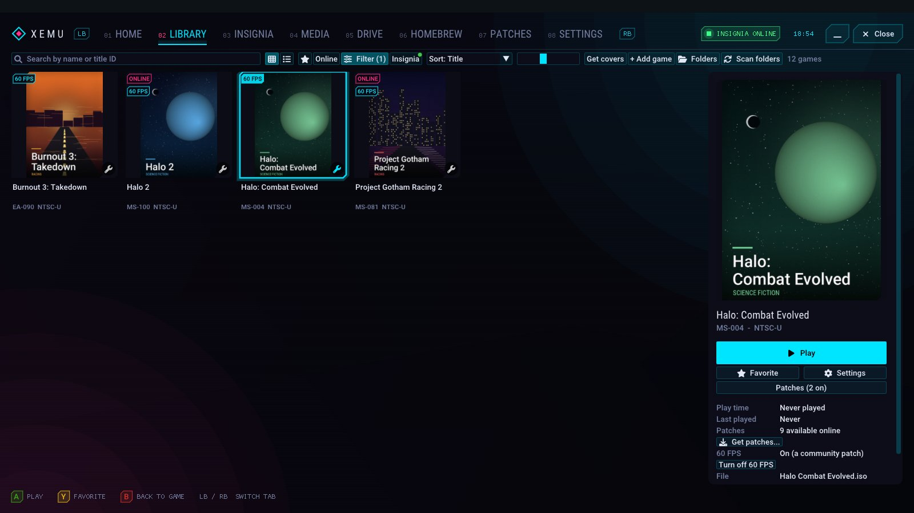
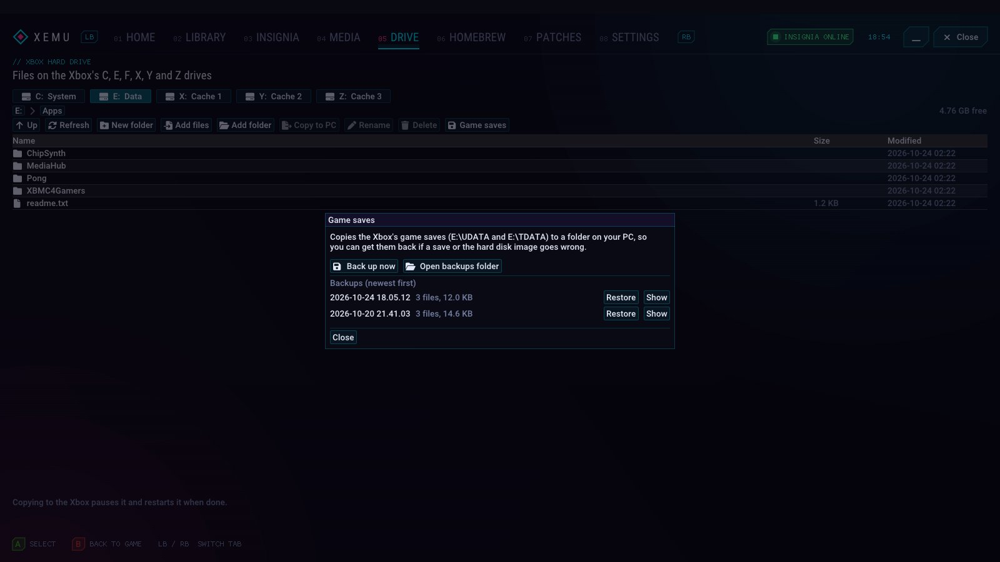
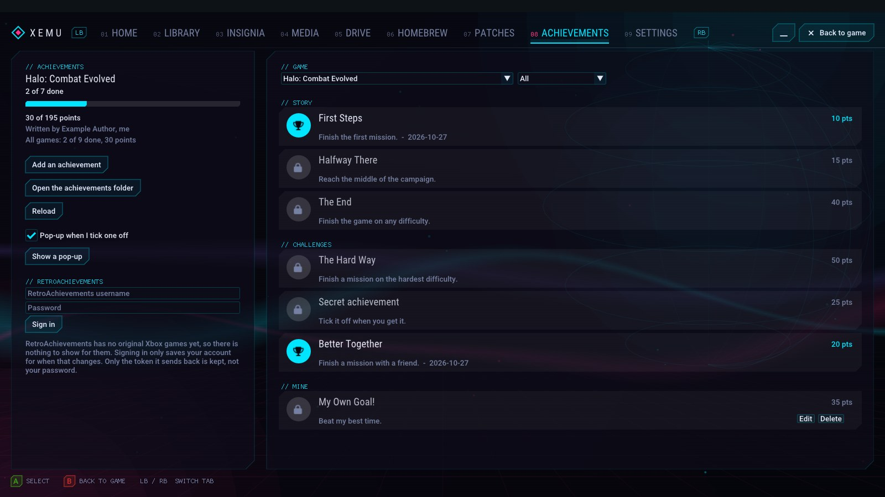

# xemu Modern GUI

**An experimental, unofficial fork of [xemu](https://xemu.app) 0.8.139 with a console-style dashboard.**

> [!IMPORTANT]
> This fork is for trying out user interface ideas. It is **not** official
> xemu and is not made, endorsed or supported by the xemu project.
>
> - **Please don't ask about this build in xemu's Discord, GitHub or other
>   xemu channels.** Report problems in this repository instead.
> - If something doesn't work, try official xemu first to see whether xemu
>   itself has the problem.
> - For the official emulator, downloads and support, go to
>   [xemu.app](https://xemu.app).

> [!NOTE]
> **Vibe coded with Claude.** Every change in this fork was written by an AI,
> [Claude Code](https://claude.com/claude-code) from Anthropic, from
> plain-language requests by the repository owner, who tests the builds and
> publishes the releases. The emulator underneath is xemu's own code; the
> changes on top haven't had the review a long-running project gets. Expect
> rough edges.
>
> **Agent Declaration**: These changes were created with assistance from
> Claude Code (Anthropic, Claude Sonnet 5.5; earlier versions Claude Opus 5.5).

Emulation is unchanged except where noted under
[Performance and stability](#performance-tools-and-stability). The work is on
the interface: a dashboard in 11 languages that works fully with a controller,
one-click 60 FPS patches, upscaling and CRT filters, a homebrew tab and store,
save backups, tools for finding out why a game is slow, a guided Insignia
setup, and, new in v2.1, per-game keyboard and mouse setups and an
experimental achievements tab.

## Highlights

- **Console-style dashboard** with Home, Library, Insignia, Media, Drive,
  Homebrew, Patches and Settings tabs, four styles and two themes. Everything
  works from a controller.
- **Game library** with cover art, play time, per-game settings, preview
  videos, save states and resume.
- **One-click 60 FPS, widescreen and HD patches** without touching your disc
  images.
- **Keyboard, mouse and controller together** as a single input choice, with
  per-game keys and mouse buttons (v2.1).
- **Picture quality:** FSR, NVIDIA RTX Video, NIS, Snapdragon GSR, Lanczos,
  Bicubic, CRT TV and scanline filters.
- **Homebrew tab and store**, plus an Xbox hard drive explorer and save
  backups.
- **Guided Insignia setup** for online play.
- **Performance Capture** to find out why a game slows down.
- **Achievements (experimental, work in progress):** fan-made packs you tick
  off yourself (v2.1).

| Library | Homebrew | Homebrew store | Drive |
|---|---|---|---|
|  |  |  |  |

| Insignia | Blades style | Metro style | Classic style |
|---|---|---|---|
|  |  |  |  |

| On-screen keyboard | Performance Capture | Settings | Setup check |
|---|---|---|---|
|  |  |  |  |

| 60 FPS games | Game saves | Achievements |
|---|---|---|
|  |  |  |

| Deutsch | 日本語 | Русский |
|---|---|---|
|  |  |  |

Screenshots use original placeholder cover art (not the real box art), example compatibility ratings, invented example homebrew and example achievements and progress. The Performance Capture screenshot shows a real recording of Project Gotham Racing.

## Download

Windows builds are on the [Releases](../../releases) page. Unzip and run
`xemu.exe`. It uses the same settings folder as official xemu, so existing
settings, EEPROM and hard disk images carry over.

You still need your **own** MCPX boot ROM, BIOS (flash ROM) and hard disk
image, the same as with official xemu. They are not included and must not be
shared.

Windows is the only platform with prebuilt downloads. Linux and macOS
builds from source are untested.

**Updating:** from v1.4 on, **Help > Check for Updates** finds new releases
of this fork (not official xemu) and installs them in place; it also checks
at startup if "Check for updates" is on. New users get a **setup check** on
the Home tab that points out any missing files.

## What's added

A summary of everything this fork adds. For what changed in each version,
see the [Releases](../../releases) page.

### A console-style dashboard

- **Four styles**, switchable any time: the tabbed **Dashboard**, **Blades**
  (sliding side-by-side panels), **Metro** (slim XBMC4Gamers-style lists)
  and the **Classic** single library window.
- **Two themes:** **Neon** (near-black with cyan and magenta, cut-corner
  panels and HUD labels) and **Green** (the rounded look in xemu green).
- **Motion:** flowing light ribbons, a turning wireframe orb, drifting
  specks, tab transitions and a gliding selection glow. Can be turned off.
- **Tabs**, switched with LB / RB: **Home** (continue your last game),
  **Library**, **Insignia**, **Media** (save states and screenshots),
  **Drive**, **Homebrew**, **Patches** and **Settings**.
- **Built for controllers:** everything works from a gamepad, with button
  hints along the bottom.
- **On-screen keyboard:** select any text box with a controller and a
  keyboard in the dashboard's colors slides up. D-pad to pick a key, A to
  type, X to delete, Y for a space, LT for symbols, RT for capitals, B to
  close. Can be turned off in Settings.
- **Minimize:** tuck the dashboard away to a small tab at the bottom of the
  screen and bring it back with one click, Ctrl+L or the Guide button menu.
- **11 languages:** English, Español, Português (Brasil), Français,
  Deutsch, Italiano, Polski, Русский, 日本語, 简体中文 and 한국어. It follows
  your Windows language; change it on the welcome screen or in Settings.
  Translations were made with AI help and live in
  [`ui/xui/lang`](ui/xui/lang); corrections are welcome.
- **Setup check:** new users see what's missing (MCPX boot ROM, BIOS, hard
  disk image, games folder) with a button to fix each.
- **Updates built in:** Help > Check for Updates installs new releases of
  this fork in place.

### Your game library

- **Multiple game folders**, cover art downloads, play time, favorites,
  filters (compatibility, played / never played) and sorting.
- **3D game cases** on Home, made from your covers, or your own 3D box art
  (`covers\<title ID>-3d.png`).
- **Compatibility ratings** from xemu's community
  [compatibility list](https://xemu.app/#compatibility) on every game.
- **Per-game settings:** resolution, upscaling filter, sharpening and
  renderer (one game on OpenGL, the rest on Vulkan).
- **Preview videos**, **desktop shortcuts**, a **resume where you left
  off** option and **save states** with thumbnails and a right-click menu.
- **Discord status** showing the game you're playing, with its cover and
  play time.
- **Quick save and load from the controller:** Back + LB saves the game
  you're playing, Back + RB loads it (one quick save per game).

### Patches

- Per-game XBE, IPS, BPS and Magic Patch (.jmp) files, applied without
  modifying the disc image.
- Download widescreen, 60 FPS and HD patches from
  [Jay's Magic Patches](https://github.com/JayYardley/Xbox-Magic-Patches-by-Jay)
  for your whole library at once.
- **One-click 60 FPS:** games with a community 60 FPS patch (over 70 games)
  get a badge and a switch; xemu downloads the patch if needed and turns
  on just its 60 FPS options.

### Homebrew and the Xbox hard drive

- **Homebrew tab:** play the homebrew on your Xbox hard disk image
  (`E:\Games`, `E:\Apps`, `E:\Emulators`) straight from the dashboard; xemu
  turns the app's folder into a disc image and boots it. Covers come from
  the store, your own files or the app itself.
- **Homebrew store:** browse [XboxHomebrew.store](https://xboxhomebrew.store)
  (run by Team Resurgent), read about an app and **Install to Xbox** in one
  click. Only homebrew is listed.
- **Drive tab:** an Xbox hard drive explorer for the C, E, F and X/Y/Z
  partitions. Copy files and folders in and out, rename and delete, with
  game names shown next to save folders (uses
  [libfatx](https://github.com/mborgerson/fatx)).
- **Game save backups:** copy the Xbox's saves (`E:\UDATA`, `E:\TDATA`) to
  a dated folder on your PC and put a backup back in one click.
- **Safe save states:** a save state puts the whole Xbox back, hard drive
  included, so loading one made before you installed homebrew or changed
  the drive would undo that. xemu remembers those changes and asks first,
  with "Start the game without it" to keep the drive as it is.

### Online play with Insignia

- **ONLINE badges** on supported games, a status light in the top bar and
  an Insignia tab listing your online-capable games.
- **One-click setup:** "Set up xemu for Insignia" turns on networking and
  answers the Xbox's DNS lookups with Insignia's server, so nothing has to
  be changed in the Xbox dashboard. "Test connection" checks it from your
  PC.
- **Account walkthrough:** step by step from networking to playing online.
  One button downloads Insignia's Setup Assistant from their GitHub page,
  installs it on the Xbox drive and starts it; closing it brings you back
  to the next step. Then get an invite code and create your Xbox Live
  account in the Xbox dashboard.

### Picture quality

- **Upscaling filters:** AMD FidelityFX FSR 1.0, **NVIDIA RTX Video (AI)**
  (RTX cards), NVIDIA Image Scaling (NIS), Snapdragon GSR 1, Lanczos and
  Bicubic, with a sharpening control.
- **CRT TV and Scanlines:** the look of an old TV (scanlines that follow
  the Xbox's own lines, an aperture-grille mask and curved glass), with a
  strength slider, and an **Integer (pixel-perfect)** display mode.
- **Video mode switches:** widescreen, 480p, 720p and 1080i, the same as
  the Xbox dashboard's settings.

### Achievements (experimental, work in progress)

> [!WARNING]
> Achievements are **experimental and still being worked on**. Expect missing
> features, rough edges and changes between versions, including to the pack
> format. Progress is kept in `achievements.json`; keep a copy of any packs you
> write.

- **Achievements for each game.** The original Xbox had none (Gamerscore
  came with the Xbox 360), and no fan-made collection turned up either, so
  nothing is built in. They come from **achievement packs**: small JSON files
  named after a game's title ID (for example `4D530004.json`) in the
  `achievements` folder next to your library. Anyone can write and share
  one. The format is in [docs/achievement-packs.md](docs/achievement-packs.md),
  with a starting file in
  [docs/achievement-pack-example.json](docs/achievement-pack-example.json).
- **You tick them off yourself.** xemu can't see inside a game, so it can't
  tell when you've done something. A pop-up slides in at the lower right when
  you tick one (it can be switched off, and "Show a pop-up" tries it).
- **Unlock by itself (new, experimental):** an achievement can have a
  *trigger*: conditions about numbers in the running game's memory, like
  "lives is 0" or "level is at least 5". xemu checks them while the game
  runs and unlocks the achievement when they hold. The **Address finder**
  (button in the Achievements tab) helps you find those numbers, like a
  cheat search: look for a value, change it in the game, look again. It only
  reads memory, never changes it. Triggers need someone to find the addresses
  game by game, so only games people have set up unlock this way; see
  [docs/achievement-packs.md](docs/achievement-packs.md).
- **The Achievements tab** has a game picker, a progress bar with points and
  the list for the game (grouped, filterable, with secret ones hidden until
  you get them). Games without a pack are listed too.
- **Write your own:** "Add an achievement" makes one for the selected game,
  and you can edit or delete it later. Yours are kept in
  `<TITLEID>-mine.json`, next to the packs.
- **Community packs:** "Browse community packs..." lists packs other people
  have shared in this repository's [community-packs](community-packs/) folder
  and downloads the ones you pick. Each file is size-limited and checked
  before it is saved, and only shown as text. To share yours, open a pull
  request (the folder's README explains how). The list is empty so far.
- **RetroAchievements sign-in:** you can sign in with a
  [RetroAchievements](https://retroachievements.org) account. It has no
  original Xbox games yet, so for now this only keeps your account ready for
  when that changes. Your password is never saved, only the token
  RetroAchievements sends back.

### Controllers, keyboard and mouse

- **"Keyboard, mouse and controller" input choice:** in Settings > Input (or
  the dashboard's Settings tab, which has the same pickers for ports 1 to 4),
  pick it for a port and that port hears the keyboard, the mouse and every
  connected controller at once. Nothing to switch and no button to press
  first. The mouse is captured by itself while you play (F3 lets go, a click
  takes it back) and can be turned off.
- **Mouse:** moves the right stick (or the left, your choice) with its own
  sensitivity. Choose what each mouse button, the side buttons and the wheel
  do (any Xbox button or trigger; by default left click is the right trigger,
  right click the left trigger and middle click R3). **Use WASD + mouse
  layout** binds a ready-made keyboard layout in one click.
- **Test your controller:** the dashboard's Settings tab draws a controller
  that lights up as you press buttons and move the sticks and triggers, to
  check that it reaches xemu. Press **Start test** first: while it runs, the
  controller doesn't scroll the page, go back or change tabs. Stop it with
  the button, Esc, or by holding Back + Start for 2 seconds.
- **Resuming keeps your controllers:** when you resume a game or load a saved
  state from the library, your controllers are plugged in again so the game
  doesn't sit on a "connect a controller" message.
- **Keys and mouse for each game:** in a game's settings, "Own keyboard and
  mouse setup for this game" gives it its own keys, mouse speed and mouse
  buttons, switched on when the game starts and put back when it's done.
  Start from a preset by kind of game (shooter or action, racing, fighting,
  sports and platformers) or xemu's own keys, then change any key. The
  presets are sensible starting points, not each game's own layout;
  "Suggested for this game" picks one by the game's name, as a guess only.
- **On-screen keyboard capitals:** hold RT (R2) for capitals and LT (L2) for
  symbols.
- **Quick save buttons for modern controllers:** quick save and load were
  Back + LB/RB, and modern controllers have no button called Back (it's View
  on Xbox One and Series, Share on PS4, Create on PS5). Choose what you press
  while holding that button: LB/RB, the triggers, stick clicks or D-pad
  left/right. The hints show the right button names for your controller.
- **Rumble strength** for every controller, from full to off.

### Sound

- **Output device:** send the game's sound to headphones, speakers or the
  TV without changing the Windows default.
- **Background audio:** keep playing, play quieter or mute when xemu isn't
  the active window.
- **Per-game volume** for games that are much louder or quieter than the
  rest.

### Performance tools and stability

- **Performance Capture:** find out why a game slows down or glitches.
  Press Shift+F9 to record and Shift+F12 to mark a glitch. The report
  graphs every frame and explains in plain words what changed when the
  game slowed down, with a summary picture for sharing and a trace for
  [Perfetto](https://ui.perfetto.dev). Optional **voice commands**
  ("Performance capture start / stop / mark") using Windows speech
  recognition.
- **Performance overlay** (F9) and a "Preparing shaders" indicator.
- **Dynamic resolution (experimental):** lowers the internal resolution
  when a game runs slow and raises it again when there's room.
- **Shader caches:** Vulkan shader and pipeline caches, OpenGL reusing
  saved shaders even after a crash, and **Clear shader cache** per game or
  for all games.
- **Under the hood:** higher-priority emulation threads, a larger CPU code
  cache, Windows power throttling turned off, and fixes for some Vulkan and
  audio crashes. These are the only changes to emulation.

The changes live on the `enhanced` branch, based on the `v0.8.139` release.

## Building

The same as official xemu: `./build.sh` (or `./build.sh -p win64-cross` for
Windows). See the [xemu documentation](https://xemu.app/docs/dev/building-from-source/).

## License

xemu is licensed under the GNU GPL v2 (see `LICENSE` and `COPYING`), and so
are the changes in this fork. Patch files downloaded at runtime remain the work
of their authors.
