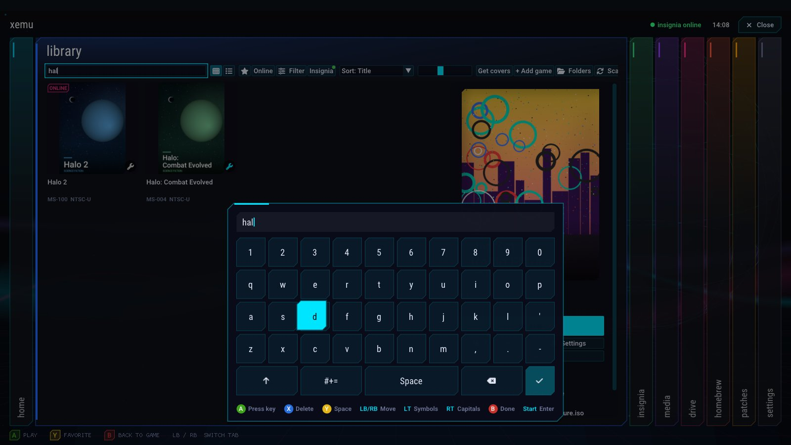
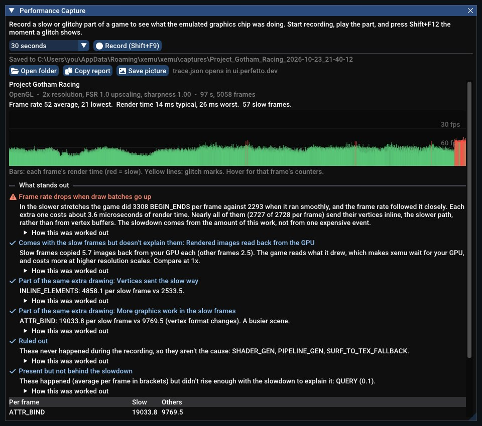
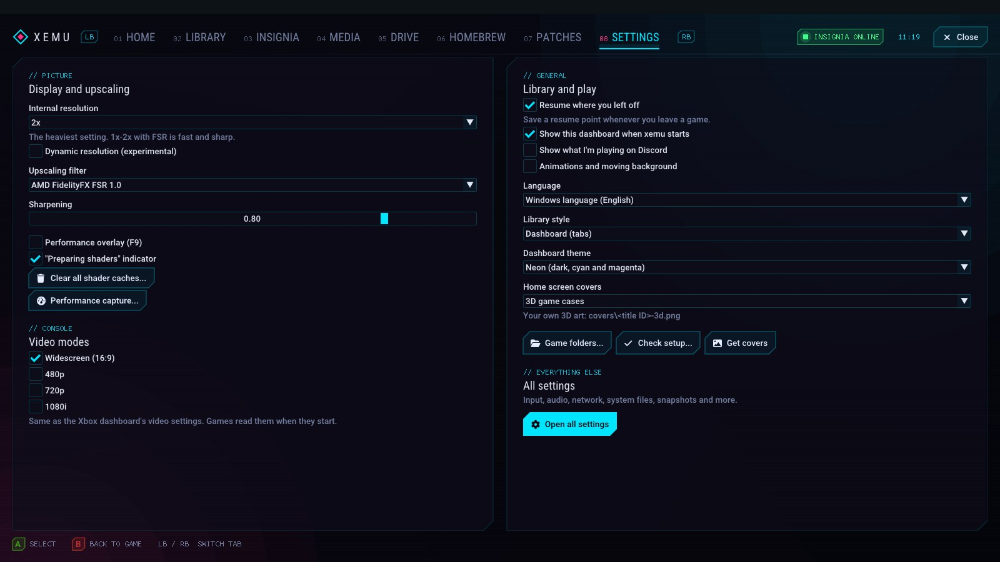
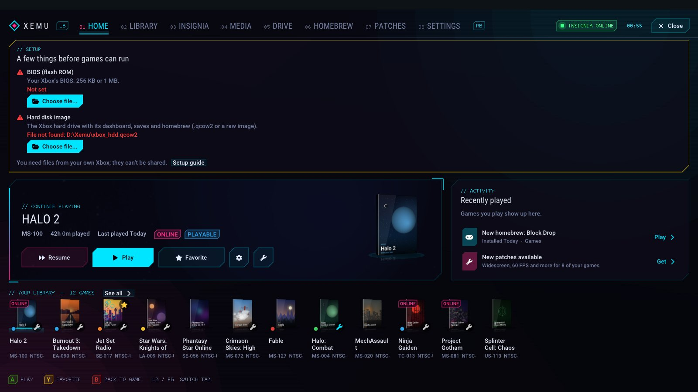
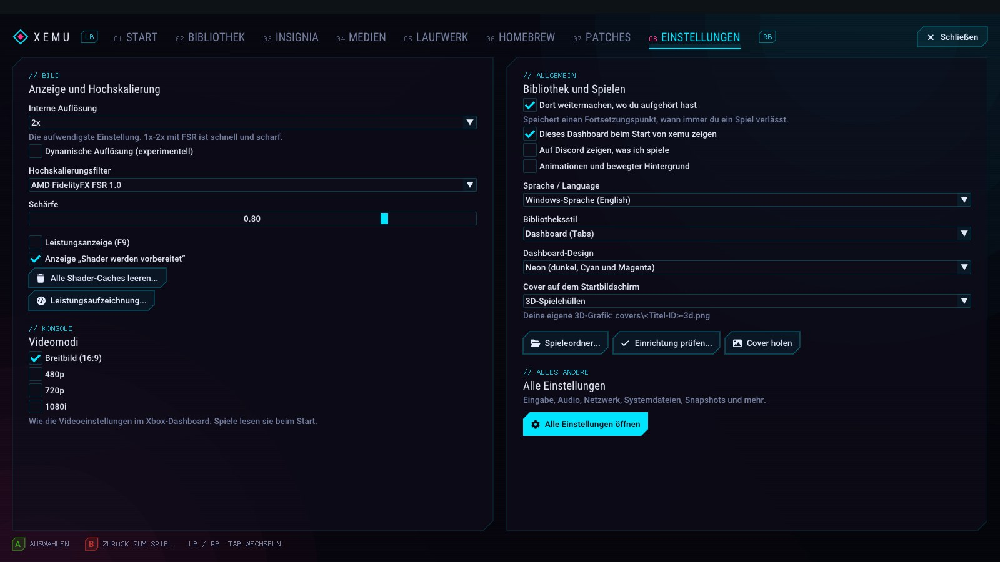
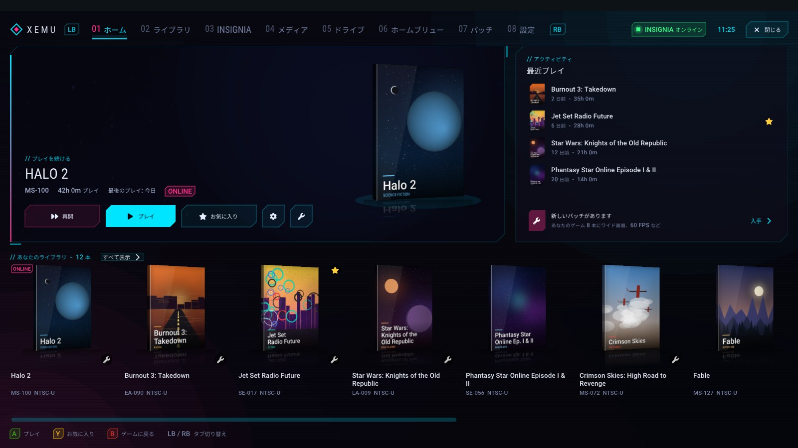
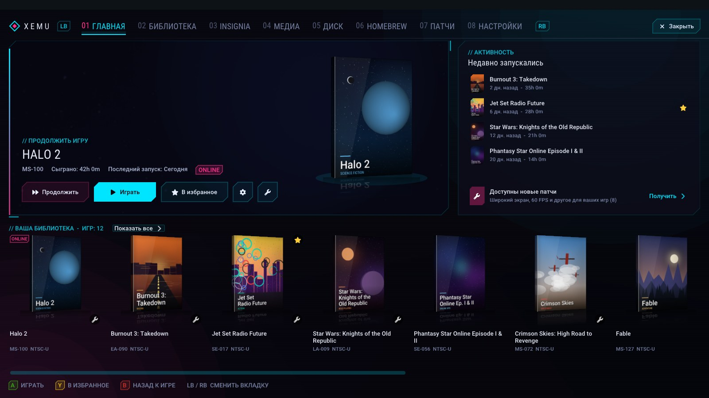

# xemu Modern GUI: an experimental xemu fork

> [!IMPORTANT]
> **This is an experimental fork of [xemu](https://xemu.app) for trying out
> user interface improvements.** It is not official xemu, and it is not made,
> endorsed or supported by the xemu project. Some of these ideas may never
> appear in xemu.
>
> - **Please don't ask about this build in xemu's Discord, GitHub or other
>   xemu channels**, and don't report its problems there. Open an issue in
>   this repository instead.
> - If something doesn't work, try official xemu before assuming xemu has
>   the problem.
> - For the official emulator, downloads and support, go to
>   [xemu.app](https://xemu.app).

This fork is based on xemu 0.8.139. Emulation is unchanged except where noted
under Performance and stability; the work here is on the interface: a
console-style dashboard in 11 languages that works fully with a controller
(on-screen keyboard included), a homebrew tab and store, upscaling options,
tools for finding out why a game is slow, a guided Insignia setup, and
quality-of-life features.

> **Agent Declaration**: These changes were created with assistance from
> Claude Code (Anthropic, Claude Opus 5.5).

| Library | Homebrew | Homebrew store | Drive |
|---|---|---|---|
|  |  |  |  |

| Insignia | Blades style | Metro style | Classic style |
|---|---|---|---|
|  |  |  |  |

| On-screen keyboard | Performance Capture | Settings | Setup check |
|---|---|---|---|
|  |  |  |  |

| Deutsch | 日本語 | Русский |
|---|---|---|
|  |  |  |

Screenshots use original placeholder cover art (not the real box art), example compatibility ratings and invented example homebrew. The Performance Capture screenshot shows a real recording of Project Gotham Racing.

## Download

Windows builds are on the [Releases](../../releases) page. Unzip and run
`xemu.exe`. It uses the same settings folder as official xemu, so existing
settings, EEPROM and hard disk images carry over.

You still need your **own** MCPX boot ROM, BIOS (flash ROM) and hard disk
image, the same as with official xemu. They are not included and must not be
shared.

**Updating:** from v1.4 on, **Help > Check for Updates** finds new releases
of this fork (not official xemu) and installs them in place; it also checks
at startup if "Check for updates" is on. New users get a **setup check** on
the Home tab that points out any missing files.

## What's added

A summary of everything this fork adds. For what changed in each version,
see the [Releases](../../releases) page.

### A console-style dashboard

- **Four styles**, switchable any time: the tabbed **Dashboard**, **Blades**
  (sliding side-by-side panels), **Metro** (slim XBMC4Gamers-style lists)
  and the **Classic** single library window.
- **Two themes:** **Neon** (near-black with cyan and magenta, cut-corner
  panels and HUD labels) and **Green** (the rounded look in xemu green).
- **Motion:** flowing light ribbons, a turning wireframe orb, drifting
  specks, tab transitions and a gliding selection glow. Can be turned off.
- **Tabs**, switched with LB / RB: **Home** (continue your last game),
  **Library**, **Insignia**, **Media** (save states and screenshots),
  **Drive**, **Homebrew**, **Patches** and **Settings**.
- **Built for controllers:** everything works from a gamepad, with button
  hints along the bottom.
- **On-screen keyboard:** select any text box with a controller and a
  keyboard in the dashboard's colors slides up. D-pad to pick a key, A to
  type, X to delete, Y for a space, LT for symbols, RT for capitals, B to
  close. Can be turned off in Settings.
- **Minimize:** tuck the dashboard away to a small tab at the bottom of the
  screen and bring it back with one click, Ctrl+L or the Guide button menu.
- **11 languages:** English, Español, Português (Brasil), Français,
  Deutsch, Italiano, Polski, Русский, 日本語, 简体中文 and 한국어. It follows
  your Windows language; change it on the welcome screen or in Settings.
  Translations were made with AI help and live in
  [`ui/xui/lang`](ui/xui/lang); corrections are welcome.
- **Setup check:** new users see what's missing (MCPX boot ROM, BIOS, hard
  disk image, games folder) with a button to fix each.
- **Updates built in:** Help > Check for Updates installs new releases of
  this fork in place.

### Your game library

- **Multiple game folders**, cover art downloads, play time, favorites,
  filters (compatibility, played / never played) and sorting.
- **3D game cases** on Home, made from your covers, or your own 3D box art
  (`covers\<title ID>-3d.png`).
- **Compatibility ratings** from xemu's community
  [compatibility list](https://xemu.app/#compatibility) on every game.
- **Per-game settings:** resolution, upscaling filter, sharpening and
  renderer (one game on OpenGL, the rest on Vulkan).
- **Preview videos**, **desktop shortcuts**, a **resume where you left
  off** option and **save states** with thumbnails and a right-click menu.
- **Discord status** showing the game you're playing, with its cover and
  play time.
- **Quick save and load from the controller:** Back + LB saves the game
  you're playing, Back + RB loads it (one quick save per game).

### Patches

- Per-game XBE, IPS, BPS and Magic Patch (.jmp) files, applied without
  modifying the disc image.
- Download widescreen, 60 FPS and HD patches from
  [Jay's Magic Patches](https://github.com/JayYardley/Xbox-Magic-Patches-by-Jay)
  for your whole library at once.
- **One-click 60 FPS:** games with a community 60 FPS patch (over 70 games)
  get a badge and a switch; xemu downloads the patch if needed and turns
  on just its 60 FPS options.

### Homebrew and the Xbox hard drive

- **Homebrew tab:** play the homebrew on your Xbox hard disk image
  (`E:\Games`, `E:\Apps`, `E:\Emulators`) straight from the dashboard; xemu
  turns the app's folder into a disc image and boots it. Covers come from
  the store, your own files or the app itself.
- **Homebrew store:** browse [XboxHomebrew.store](https://xboxhomebrew.store)
  (run by Team Resurgent), read about an app and **Install to Xbox** in one
  click. Only homebrew is listed.
- **Drive tab:** an Xbox hard drive explorer for the C, E, F and X/Y/Z
  partitions. Copy files and folders in and out, rename and delete, with
  game names shown next to save folders (uses
  [libfatx](https://github.com/mborgerson/fatx)).
- **Game save backups:** copy the Xbox's saves (`E:\UDATA`, `E:\TDATA`) to
  a dated folder on your PC and put a backup back in one click.

### Online play with Insignia

- **ONLINE badges** on supported games, a status light in the top bar and
  an Insignia tab listing your online-capable games.
- **One-click setup:** "Set up xemu for Insignia" turns on networking and
  answers the Xbox's DNS lookups with Insignia's server, so nothing has to
  be changed in the Xbox dashboard. "Test connection" checks it from your
  PC.
- **Account walkthrough:** step by step from networking to playing online.
  One button downloads Insignia's Setup Assistant from their GitHub page,
  installs it on the Xbox drive and starts it; closing it brings you back
  to the next step. Then get an invite code and create your Xbox Live
  account in the Xbox dashboard.

### Picture quality

- **Upscaling filters:** AMD FidelityFX FSR 1.0, **NVIDIA RTX Video (AI)**
  (RTX cards), NVIDIA Image Scaling (NIS), Snapdragon GSR 1, Lanczos and
  Bicubic, with a sharpening control.
- **CRT TV and Scanlines:** the look of an old TV (scanlines that follow
  the Xbox's own lines, an aperture-grille mask and curved glass), with a
  strength slider, and an **Integer (pixel-perfect)** display mode.
- **Video mode switches:** widescreen, 480p, 720p and 1080i, the same as
  the Xbox dashboard's settings.

### Sound and controllers

- **Output device:** send the game's sound to headphones, speakers or the
  TV without changing the Windows default.
- **Background audio:** keep playing, play quieter or mute when xemu isn't
  the active window.
- **Per-game volume** for games that are much louder or quieter than the
  rest.
- **Rumble strength** for every controller, from full to off.

### Performance tools and stability

- **Performance Capture:** find out why a game slows down or glitches.
  Press Shift+F9 to record and Shift+F12 to mark a glitch. The report
  graphs every frame and explains in plain words what changed when the
  game slowed down, with a summary picture for sharing and a trace for
  [Perfetto](https://ui.perfetto.dev). Optional **voice commands**
  ("Performance capture start / stop / mark") using Windows speech
  recognition.
- **Performance overlay** (F9) and a "Preparing shaders" indicator.
- **Dynamic resolution (experimental):** lowers the internal resolution
  when a game runs slow and raises it again when there's room.
- **Shader caches:** Vulkan shader and pipeline caches, OpenGL reusing
  saved shaders even after a crash, and **Clear shader cache** per game or
  for all games.
- **Under the hood:** higher-priority emulation threads, a larger CPU code
  cache, Windows power throttling turned off, and fixes for some Vulkan and
  audio crashes. These are the only changes to emulation.

Every change is a separate commit on the `enhanced` branch, based on the
`v0.8.139` release.

## Building

The same as official xemu: `./build.sh` (or `./build.sh -p win64-cross` for
Windows). See the [xemu documentation](https://xemu.app/docs/dev/building-from-source/).

## License

xemu is licensed under the GNU GPL v2 (see `LICENSE` and `COPYING`), and so
are the changes in this fork. Patch files downloaded at runtime remain the work
of their authors.
